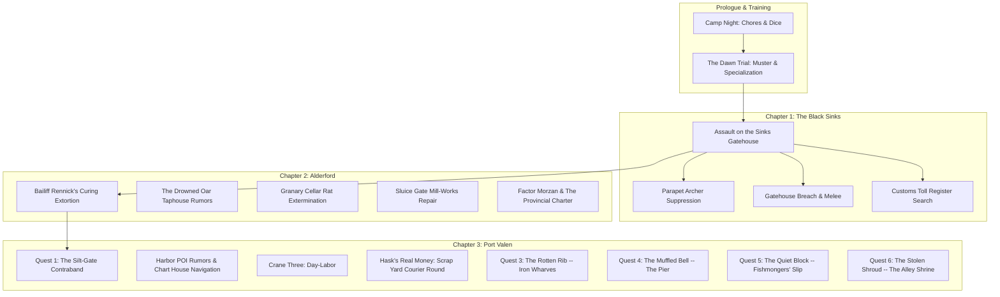

# Quests & Contracts Reference — The Carrion Company

A developer reference for every major quest, side contract, municipal task, and investigation across *A Mercenary's Path*. Keep this updated whenever a new quest, objective stage, or resolution branch is added.

---

## Quest State Architecture & Standards

All quests use standardized ChoiceScript lifecycle variables declared in `startup.txt`:
1. **Stage Flag (`[quest_name]_quest_stage`):**
   - `"unstarted"` — Initial state before the briefing, notice, or trigger event.
   - `"active"` — Accepted / ongoing; unlocks investigation choices, district travel goals, and POI scenes.
   - `"resolved"` — Finished; locks out repeatable investigation branches and updates district ambient prose.
2. **Resolution Flag (`[quest_name]_resolution`):**
   - Stores the narrative path taken (e.g. `"watch_seized"`, `"hush_money"`, `"leverage"`, `"scales_extorted"`).
3. **Intel & Evidence Flags:**
   - Tracks discovered clues, stolen manifests, or extracted names (`[quest_name]_full_intel`, `found_customs_vellum`, etc.).
4. **Reward & Claim Flags:**
   - One-time payout protection (`[quest_name]_bounty_claimed`), reputation boosts (`port_watch_rep`, `gilded_scales_rep`, `black_oath_rep`, `vane_standing`), and unique items (`has_silt_gate_payout_slip`).

---

## Chapter Overview



---

## Chapter 1: The Black Sinks (`battle_black_sinks.txt`)

### 1. Assault on the Sinks Gatehouse
* **Scene File:** `battle_black_sinks.txt`
* **Briefing / Origin:** Captain Vane & squad sergeants prior to the causeway charge.
* **Core Objectives:**
  1. Cross the flooded mud-causeway under missile fire.
  2. Suppress the parapet archers and defensive barricades.
  3. Breach the iron-studded oak gatehouse and break the defending line.
* **Investigation / Sub-Objectives:**
  * **Search the Sinks Toll-House (`bivouac_search`):** Search the water-damaged office to recover the *Grey Waterway Toll Register* vellum (`found_customs_vellum = true`).
  * **Repair with Magic:** Use `[Cantrip: Mending]` to restore the torn vellum and salt-soaked seals.
* **Key Variables:**
  * `found_customs_vellum` (boolean) — Held in pack for leverage in Chapter 2 (Alderford).
  * `customs_register_restored` (boolean) — Repaired via Mending or careful drying.

---

## Chapter 2: Alderford River Hub (`alderford.txt`)

### 1. The Fish-Curing Lofts Extortion
* **Scene File:** `alderford.txt` (`alderford_fish_curing`)
* **Briefing:** River workers cornered by Bailiff Rennick and two iron-cudgel thugs shaking down the drying lofts for illegal toll-tribute.
* **Resolution Paths:**
  1. **Provincial Charter Leverage:** Slam the *Grey Waterway Toll Register* onto the salting bench (`found_customs_vellum`), citing Section 12 to expose Rennick's debt as unsanctioned extortion (Automatic Success).
  2. **Thaumaturgy / Arcane Intimidation:** Booming command with violet flaring lantern light (`CHA DC 10` / Tiefling / Spellcaster).
  3. **Martial Feat of Strength:** Snap a 3-inch oak curing beam barehanded (`STR DC 10` / Fighter / Barbarian).
  4. **Sleight of Hand Disarm:** Slice Rennick's purse-strings and kick his lead guard's knee (`DEX DC 10` / Rogue).
  5. **Physical Combat:** Full squad brawl against Rennick's cudgel-men (`combat.txt`).
* **Rewards:** +10–18 Silver Marks, Alderford worker regard, unlocks Gilded Scales leverage.

### 2. The Granary Cellar Infestation
* **Scene File:** `alderford.txt` (`alderford_granary`)
* **Briefing:** Mill master offers silver to clear aggressive bog-rats nesting beneath grain chutes.
* **Resolution Paths:**
  1. Tactical extermination / rat combat (`combat.txt` — `fight_granary_rats`).
  2. Trapping and barrier construction (`INT DC 11` / `DEX DC 11`).
* **Rewards:** +12 Silver Marks, clean meal rations.

### 3. Factor Morzan & The Provincial Charter
* **Scene File:** `alderford.txt` (`alderford_counting_house`)
* **Briefing:** Deliver the recovered Black Sinks Toll Register to the Gilded Scales counting house.
* **Resolution Paths:**
  1. Turn in the vellum for full guild contract price (+40 Silver Marks, `+2 gilded_scales_rep`).
  2. Leverage the tax skims to secure merchant concessions for the Carrion Company supply train.
* **Variables:** `turned_in_customs_vellum = true`.

---

## Chapter 3: Port Valen Municipal Quests (`port_valen.txt`)

### Quest 1: The Silt-Gate Contraband
* **Scene File:** `port_valen_dredge_end.txt` (`pv_dredge_silt_gates`, `pv_silt_gate_stakeout`, `pv_silt_gate_squeeze`); Kestrel's side in the watchtower (`pv_tower_silt`, `pv_tower_silt_turnin`) and Voss's desk at the Harbor Quayside (`pv_quays_voss_briefing`, `pv_quays_voss_chat`) in `port_valen.txt`.
* **District:** Dredge-End (Low drainage flume & tidal vault).
* **Briefing:** Dockmaster Voss reports uninspected highland shear-steel and illicit peat-spiritus entering through the tidal flap-valves during midnight flood tides. He's a customs official, not a Watch officer — he can catch corruption near his docks and escalate it hard, but every consequence he promises routes through "the Watch captain," never his own authority.
* **Starts with Kestrel (converted 2026-10-06, like the Rotten Rib):** Vane tells every player to go up the watchtower after dark. There, "Tell her Vane said she has a use for you" (`silt_gate_quest_stage = "unstarted"`, sets `kestrel_silt_briefed`) is her brief: the Watch's night sergeants are paid to walk the far bank, she needs the broker's own list to keep them in her pocket, the player should take Voss's job as cover, and she pays 5 silver for both names. Voss's briefing button needs `kestrel_silt_briefed`; before that he only talks traffic.
* **Voss:** still gives the quest, but is never told the result and is never paid. Three days after the player hands the slip to Kestrel, his chat says Sergeant Kray, who never noticed him in eleven years, has started saluting him and the men on the far bank have turned polite, though it is no better watched, and that he has decided not to ask (Kestrel is keeping the sergeants quiet, not spending them) (`silt_gate_turned_in_day`, `silt_gate_voss_told`).

#### Objective Flow:
1. **Daytime Recon (`pv_dredge_silt_gates`):**
   * Map roofline blind spots and spot the lantern-boy (`silt_gate_lookout_spotted = true`).
   * Jam the street-level storm-winch counterweight cog (`silt_gate_winch_jammed = true`).
   * Study high-tide charcoal marks on the stone vault.
   * `[Cantrip: Mage Hand]` - Remotely wedge an iron bolt into the winch cog from the canal shadows.
2. **Night Stakeout (`pv_silt_gate_stakeout`):**
   * Wait for night flood tide (`[~2 Hours]`).
   * `[Cantrip: Guidance]` - Divination focus buff (`+1d4` to next check).
   * `[Cantrip: Prestidigitation]` - Snuff the platform's fish-oil lamp from afar (`silt_gate_lamp_snuffed = true`, advantage on the squeeze).
   * `[Cantrip: Minor Illusion]` - Project false patrol footsteps down the north cut (`silt_gate_illusion_active = true`, advantage on the squeeze).
3. **The one ending (`pv_silt_gate_squeeze`):** pin the broker for the names on his payroll. `[CHA DC 12]` intimidate, `[STR DC 12]` search his coat, `[WIS DC 11]` offer him a way out, `[Cantrip: Thaumaturgy]` (`CHA DC 10`), `[Spell: Dissonant Whispers]` (1 Bard Slot, automatic). Advantage if the winch is jammed, the lamp snuffed or the illusion running. **The player always gets the slip with both names** (a one-name result was removed 2026-10-06 as pointless). A failed check costs something else: `silt_gate_face_seen` is set, the porters see the player's face, the player loses an hour hiding in a cellar drain, and `black_oath_heat` rises by one more (silent). Either way `silt_gate_resolution = "leverage"`, `has_silt_gate_payout_slip = true`, `black_oath_heat +1`. The crates stay on the platform.
4. **Turn-in (`pv_tower_silt_turnin`):** "Lay the broker's payout slip on the bench." `kestrel_respect +5` and 5 silver, always; she adds a line about keeping clear of Dredge-End if `silt_gate_face_seen`. Sets `kestrel_slip_turned_in`, `kestrel_watch_leverage`, `silt_gate_bounty_claimed` and `silt_gate_turned_in_day`.

* **Removed 2026-10-06:** the ambush-for-the-Watch branch (12 silver from Voss), the parley-and-bribe branch (25-30 silver hush money), the "failed" ending that only they could reach, Voss's report and the slip choices at his desk (give it to him, or lie and keep it), and the Captain Vane turn-in (`port_valen_vane_slip_turnin`, `vane_watch_leverage`, now `kestrel_watch_leverage`). The stats sheet and the Silt-Gates lorebook entry carry the one ending.
* **Why only the names:** Kestrel wants the sergeants where they are, as a door that opens when she knocks; a lockup or a bounty would spend them. The payout slip can only be handed over once.

---

### Quest 2: The Dry Lion (Middle Ward)
* **Scene File:** `port_valen/MiddlewardQuest/dry_lion.txt`; the physical entry points, services, and aftermath live in `port_valen_middle_ward.txt`.
* **District:** Conduit Square, Mother Marda's communal bakehouse, the Conduit Wash-House, and the tenement yard off Locksmiths' Close.
* **Entrance:** On Greyday, during Morning or Midday, after the player has visited both Marda and Merrin, one bronze lion-head at the public fountain coughs brown grit and falls dry. The hot-room can subsequently repeat the lead as a one-shot rumor.
* **Objective Flow:** Inspect the fountain fittings, trace the brown seep to the yard, or coordinate valve tests with Marda and Merrin. Each route exposes an old unlisted branch; deeper evidence and local support make a temporary registration possible.
* **Setback:** The yard's leaked water has undermined the paving. The crack opens as the clerk prepares to close the line, forcing an immediate choice.
* **Resolutions:**
  1. **Seal the branch:** restores the public fountain, awards 4 Silver Marks and `+1 gilded_scales_rep`, but leaves the yard without its tap (`dry_lion_resolution = "city_sealed"`).
  2. **Repair it quietly:** supports both the public line and the yard; Mending, a repair check, or a brace can hold the joint. A failed repair closes the line for two days (`"hidden_repaired"` or `"failed"`).
  3. **Register it temporarily:** with strong evidence, clerk Tomas Saye puts the branch on the roll pending inspection (`"line_registered"`).
* **Repair Kit:** The fitting and hand-repair checks mark `check_task_type = "repair"`; the shared dice engine grants the Repair Kit's automatic +1 only on these Investigation/Sleight of Hand checks.

---

### Quest 3: The Rotten Rib (The Iron Wharves)
* **Scene File:** `port_valen.txt` (`pv_poi_drydock`, `pv_poi_drydock_menu`, `beat_1_*` through `beat_4_*`, `pv_poi_brant_slipway`, and Ysolde's side in the workroom: `pv_workroom_timber`, `pv_workroom_timber_turnin`)
* **District:** Harbor Quayside, reached through the Iron Wharves POI (`pv_poi_drydock`). Also touches The Cleaved Keel (rumors) and Ysolde's workroom in the Carrion Compound (the brief and the turn-in).
* **Hub shape:** `pv_poi_drydock` pays the 15-minute entry cost once, prints the arrival vignette, and either turns the player away or lands on `pv_poi_drydock_menu`. Every yard exit returns to the menu, never to the arrival label. The menu re-checks the closing hours itself, because quest beats spend time and can carry the player past the shift bell.
* **Operating hours:** open Morning/Midday/Afternoon only. Dusk, Night, Pre-Dawn, and Storm/Blizzard close the gate (no filler choices, straight back to the quayside).
* **Briefing:** Vane starts it. In the summons scene (`port_valen_vane_summons`) he tells every player, whatever their squad, to see Ysolde this week: the Scales have held the company's timber and forage orders eleven days citing no barge space, and a raven badge is known on those wharves (`vane_timber_hint`). In her workroom, "Tell her Vane sent you about the held-up timber orders" (`rotten_rib_quest_stage = "unstarted"`, sets `ysolde_timber_briefed`) tells them the Scales claim no barge space while one of their own barges left the sheds riding low, and that she wants the paper explaining it, with its seal whole, for 5 silver the day the orders move. She names no oak and no shipwright by name, only "a shipwright on Slipway Two". The quest cannot be found any other way: the "Walk down to the drydock slipway" button in the yard and the Cleaved Keel pre-seed rumor both need `ysolde_timber_briefed`, so a player who has not been to Ysolde sees only the crane-watching and sluice-walk beats. Once briefed, the player chooses to step onto the scaffold at Slipway Two, where an old shipwright is seen testing his hull with a mallet, and he only explains once asked. The pre-seed rumor now serves as a nudge (`rotten_rib_quest_stage = "unstarted"` and briefed only).
* **Names:** the shipwright stays "the old man" in narration until the apprentices name him (Master Brant) and he names himself. Elric and Hendryk reach the player through Brant's dialogue before either appears.
* **Objective Flow:**
  1. **Slipway Two (`beat_1_*`, `beat_2_*`):** observe, question the apprentices, or approach Brant. Accepting the lead sets `rotten_rib_quest_stage = "active"` and hands over the sap-weeping splinter (`has_rotten_rib_splinter`). Declining ("not my fight") closes that conversation without starting the quest.
  2. **Timber Sheds (`beat_3_*`, 15 min):** four routes to the hidden oak behind the boiler shed, all ending at `beat_3_find_stash`:
     * `[WIS DC 11]` follow the drag-scrapes.
     * `[INT DC 11]` read the ledger notes (one attempt per visit).
     * Sawyers: `[CHA DC 12]` / `[STR DC 12]` / `[Spell: Charm Person]` / 2 silver.
     * River-gate: `[DEX DC 11]` (advantage in Fog) or `[Cantrip: Minor Illusion]`.
     * A failed approach sets `elric_alerted` instead of dead-ending. The find sets `has_diverted_timber_waybill`.
  3. **The stash choice:** the waybill is already in the player's pouch (taken at `beat_3_find_stash`, before any climax roll). Confront Elric now, report to Brant (advice on how each pressure point works), or slip away and come back later.
  4. **Elric's office (`beat_4_*`):** alerted vs. unalerted prose; Elric still offers a purse (4 or 8 silver) but it is dialogue only, with no option to take it. Re-entering from the menu costs 10 min (`beat_4_climb`). Walking out before rolling resolves nothing but sets `elric_alerted`. **Every ending leaves the player holding the waybill, so failure costs the oak and Brant, never the paper** (see `QUEST_DESIGN_RULES.md`, "Failure Must Cost Something"):
     * **Strikes.** A failed INT, STR or blackmail check gets the player thrown out by Elric's draymen (10 min). That is one strike: `elric_alerted` is set and the DC for the same checks rises from 12 to 13. A **second strike** ends the quest as `"failed"` (the oak is carted off and the ship launches on green wood; the player still has the waybill).
     * **Ledger clue.** Reading the chalk initials on the Bay Four pillar sets `rotten_rib_ledger_clue`, which gives advantage on the INT check against Elric.
* **Resolutions (one way to win, one to lose; both end with the waybill in the player's pouch):**

| Ending | How | Outcome & State |
|---|---|---|
| **Silent Leverage** (`beat_4_branch_c`) | `[INT DC 12]` cite charter law, `[STR DC 12]` intimidate, or `[CHA DC 12]` blackmail (DC 13 if alerted). The first strike is a retry at DC 13. | `rotten_rib_resolution = "blackmail"`. Oak rolled back to Brant, `brant_favor`, Brant's Iron-Heel Boots. Ysolde pays 5 silver and `ysolde_respect +5` on turn-in. |
| **Failed** (`beat_4_failed_strikes`) | A second strike | `rotten_rib_resolution = "failed"`. The ship launches on green wood. **No coin, no gear, no favor from Brant.** Ysolde still takes the waybill for `ysolde_respect +5`, and pays nothing, because the orders only move if the oak goes back. The stats sheet shows "The Ship Launched on Green Wood" and the Keel has its own rumor. |

* **Removed 2026-10-06:** the Guild Truth branch (going over Elric's head to Hendryk), the Shakedown branch (taking the purse, or extorting 14 silver), the burned-waybill failure, and the Captain Vane turn-in (`port_valen_vane_timber_turnin`, `vane_timber_turned_in`). The paper is no longer given away, destroyed or taken by anyone but Ysolde.
* **Ysolde turn-in:** from her workroom, once the quest is `"resolved"` and `has_diverted_timber_waybill` is held, "Lay the stamped waybill on her table" (`pv_workroom_timber_turnin`, once: `ysolde_timber_turned_in`). `ysolde_respect +5` on either ending; 5 silver only on `"blackmail"`. The waybill can't be turned in mid-quest.

* **Post-resolution:** with `brant_favor`, `pv_poi_brant_slipway` opens as an allied contact. Its prose branches on `campaign_day - rotten_rib_resolved_day` (ship still on the ways vs. long since launched) and on `rotten_rib_resolution`, so it stays valid on any later day. Without `brant_favor`, the menu still has the crane-watching and sluice-walk beats.
* **Rumor lifecycle:** the pre-seed rumor is only offered while unstarted. After resolution it is replaced by one outcome-specific rumor per branch (`pv_tavern_rumor_rotten_rib_after`).
* **Items:** Brant's Iron-Heel Shipwright Boots (`has_brant_iron_heel_boots`, feet slot id `brant_iron_heel_boots`, cosmetic, no AC); Sap-Weeping Spruce Splinter and Diverted Timber Waybill (evidence, shown in the dossier inventory while held).
* **Variables:** `rotten_rib_quest_stage`, `rotten_rib_resolution` (`none`, `blackmail`, `failed`), `rotten_rib_resolved`, `rotten_rib_resolved_day`, `has_rotten_rib_splinter`, `has_diverted_timber_waybill`, `ysolde_timber_briefed`, `ysolde_timber_turned_in`, `elric_alerted`, `rotten_rib_strikes`, `rotten_rib_ledger_clue`, `brant_favor`, `has_brant_iron_heel_boots`, `pv_tavern_rumor_rotten_rib`, `pv_tavern_rumor_rotten_rib_after`.

---

### Quest 4: The Muffled Bell (The Pier)
* **Scene File:** `port_valen.txt` (the gate in `pv_poi_pier`, `bell_hook`, `bell_turn_back`, `bell_b2` and `bell_b2_*`, `bell_b3` and `bell_b3_*`, `bell_fight`, `bell_won`, `bell_rescued`, `bell_fled`, `bell_b4`) and `combat.txt` (`fight_wreckers`). Design and full prose: `quest/MUFFLED_BELL_PLAN.md`.
* **District:** Harbor Quayside, the Pier. Also touches The Cleaved Keel (rumors) and the pier's lower ladders (an overheard line).
* **Trigger:** nobody offers it. The player has to have heard the old wreck story (a Keel rumor, or two skiff hands on the lower ladders by day or at dusk: `bell_heard_story`) and visited the pier once (`pv_pier_seen`). Then, arriving at Night or Pre-Dawn in weather a ship cannot see through but not a storm (Fog, Rain, Snow or Sleet: `weather_visibility` not clear and `weather_severity` under 3), there is a `bell_hook_chance` (20%) chance per visit that `pv_poi_pier` hands off to `bell_hook`. That label replaces the normal arrival, because the normal arrival has the bell tolling on nearly every branch.
* **Briefing:** the bell is silent. The striker thuds dull against the bronze, the frame post is slick with lard, a hooded figure with a rag-muffled lantern goes down the ladder into a rowboat, and two mast lanterns are lined up with the reef. Nobody is named. The player chooses: go out to the post, or turn back (which ends the quest as a loss, `bell_walked_away`).
* **Objective Flow:**
  1. **The bell (`bell_b2`, 15 min, the climax roll):** `[STR DC 12]` climb and tear the wool off, `[DEX DC 12]` throw stones at the bronze (advantage with a ranged weapon, none required), `[INT DC 12]` follow the cord and slip the hitch, `[Cantrip: Mage Hand]` and `[Cantrip: Minor Illusion]` (both succeed without a roll), and `[Cantrip: Guidance]` (+1d4, loops back). No weather modifier. Success: the ketch turns. Any failure: the ketch breaks on the reef.
  2. **The steps (`bell_b3`, 15 min):** the lantern man and the broad man come up the ladder. `[CHA DC 12]` tell them the whole harbor heard the bell, `[STR DC 12]` hold the head of the steps, or `[WIS DC 12]` give the broad man a way out. There is no fight button. Success: the Watch's light shows, and the broad man throws a pouch to buy silence and takes the boat. A failed roll starts the fight with a cost per approach: CHA gives the wreckers advantage, STR gives the player disadvantage, WIS gives both.
  3. **The fight (`fight_wreckers`):** an `axeman` (10 HP, AC 11, slashing, 30% Bleeding) and a `slinger` (6 HP, AC 10, sling, 25% Blinded) from the shared enemy library. Lethal, at the same weight as the Dredge-End ambush. HP floors at 1 (`rescued`, narrated as the Watch arriving just in time), or the player can disengage (`fled`). The combat text is the library's, place-free; the pier, the ladder and the sea live in the scene's own prose.
  4. **The pouch (`bell_b4`, 15 min):** two watchmen arrive and take over. The older one says "wreck-goods", which unlocks `codex_wreck_law`. The pouch lies on the step. Leave it, or pick it up.
* **The Watch, the bribe and the bell:** the gang paid for the post by the landing stairs to be empty. A bribe buys not being noticed, and it cannot cover a bell the whole harbor hears, which is why the Watch turns up on every success route. The player never arrests, hauls or hands anything over, and there is no Voss, Vane or faction tie-in.
* **Resolutions:**

| Route | How | Outcome & State |
|---|---|---|
| **Reported** | Leave the pouch on the step | `bell_quest_stage = "resolved"`, `bell_resolution = "reported"`. `port_watch_rep +1`, no coin. |
| **Pocketed** | Pick up the pouch | `"resolved"`, `"pocketed"`. +5 silver (50 copper), no standing. |
| **Bloodied** | The fight ends `rescued` or `fled` | `"resolved"`, `"bloodied"`. The ketch is saved and the player is hurt (HP 1 if rescued). No pouch, no coin, no standing. |
| **Wrecked** | Turn back, or fail the bell roll | `bell_quest_stage = "failed"`, `"wrecked"`. The ketch breaks on the reef and nothing is paid. `bell_walked_away` marks the turn-back version. |

* **Fail-forward:** the Beat 2 roll is the climax and its failure ends the quest, with no rescue menu. The Beat 3 failures each cost something different and never return the pouch, and a beaten player gets nothing.
* **World memory:** timeless lines at the foot of the pier arrival (a grease-stiff cord still on the cleat after any success, a hooded lantern by the stairs after the reported route, more names than the post has room for after a failure). The Keel replaces its pre-seed rumor with one outcome-specific rumor (five variants), and the wrecked ones unlock `codex_wreck_law`. The lorebook `pier` entry gets one gated sentence.
* **Items:** none.
* **Variables:** `bell_quest_stage`, `bell_resolution`, `bell_resolved`, `bell_heard_story`, `bell_walked_away`, `bell_hook_chance`, `pv_tavern_rumor_bell`, `pv_tavern_rumor_bell_after`.

---

### Quest 5: The Quiet Block (The Fishmongers' Slip)
* **Scene File:** `port_valen.txt` (`pv_poi_fish_slip`, `pv_poi_fish_slip_menu`, `pv_poi_fish_stalls`, `pv_poi_fish_gossip`, `fish_watch`, `fish_block_hub`, `fish_wenna_talk`, `fish_climax_hub`, `fish_route_*`, `fish_lawful_*`, `fish_pragmatic_*`, `fish_strategic_*`). Design and full prose: `quest/FISH_SLIP_PLAN.md`.
* **District:** Harbor Quayside, the Fishmongers' Slip. It replaces the removed Saint Althea shrine stop. Also touches The Cleaved Keel (rumors).
* **Hub shape:** `pv_poi_fish_slip` pays the 15-minute entry cost once, then lands on `pv_poi_fish_slip_menu`. The slip is closed at Dusk, Night, Storm and Blizzard (a short description and a route back, no filler choices). The auction option only appears at Pre-Dawn and Morning.
* **Market:** stalls (instant, coin-limited): fried smelt (3 copper, +1 Temp HP, +1 DEX for 4h), oysters (3 copper, +1 INT for 4h) and a plain pasty (2 copper, no buff). The Keel covers CON, STR, CHA and WIS, so the two together cover every stat. While `fish_slip_shunned` is true, every item costs one copper more. Gossip is free and keyed to the quest state.
* **Briefing:** nobody offers the quest. At the dawn auction the player watches a widow's bass go for half price with no bid, while three buyers signal with two fingers to a cap brim, a scratched ear and a glance at a boot. The player chooses to follow her. Wenna Rusk is named by herself and Thale by Wenna.
* **Objective Flow:**
  1. **The rail (`fish_watch`, 20 min):** the auction, with a state-aware aftermath scene once the quest is resolved or failed.
  2. **The block hub (`fish_block_hub`, free):** talk to the widow (sets `active`), study the buyers' hands once (`[INT DC 11]`: success sets `fish_saw_signals`, failure sets `fish_ring_wary`, and either way `fish_study_tried`), watch more lots, decide, or leave. `[Cantrip: Guidance]` loops back.
  3. **The last lot (`fish_climax_hub`):** three routes, each with one roll that is the climax. `fish_ring_wary` adds +1 DC to every route check and `fish_saw_signals` gives advantage on the INT and WIS options.
* **Resolutions (three ways to win, one to lose):**

| Route | How | Outcome & State |
|---|---|---|
| **Lawful** (`fish_route_lawful`) | The slip-warden's booth: `[INT DC 12]` lay out the pattern, or `[CHA DC 12]` be believed (DC 13 if wary) | `fish_resolution = "lawful"`. `port_watch_rep +1`, 3 silver informant's share, the ring struck off the block for the season. **Failure: `port_watch_rep -1`, `fish_slip_shunned`, quest `"failed"`.** |
| **Pragmatic** (`fish_route_pragmatic`) | Buy into the ring: `[CHA DC 12]` play a buyer's agent, or `[WIS DC 12]` answer the signals (advantage with `fish_saw_signals`) | `fish_resolution = "pragmatic"`. 5 silver from the common purse, no standing change, the widow stops speaking to you. **Failure: `fish_slip_shunned`, no coin, quest `"failed"`.** |
| **Strategic** (`fish_route_strategic`) | Needs 4 silver visible in your purse (`*selectable_if`). Bid against the ring: `[WIS DC 12]`, `[INT DC 12]` (advantage with signals) or `[Cantrip: Minor Illusion]` | `fish_resolution = "strategic"`. No coin changes hands (the stake becomes the widow's price and a cook-house runner buys the lot at what you paid), `wenna_favor`, the ring is broken. **Failure: the 4-silver stake is forfeited and the quest is `"failed"`.** |

* **Loss state:** `fish_quest_stage = "failed"`, `fish_resolution = "failed"`. The dossier shows "The Quiet Block (the ring held)", gossip and the Keel have their own failed lines, and lawful or pragmatic failure raises stall prices.
* **Wenna's favor (`wenna_favor`):** created and set on the strategic route and **reserved for future wholesale dealing at the slip**. Only the stall prose reads it for now.
* **World memory:** the auction scene changes with the outcome (new buyers bidding hard after the lawful route, the same quiet half circle after the pragmatic route or a failure, honest bidding after the strategic route).
* **Items:** none.
* **Variables:** `pv_slip_seen`, `fish_quest_stage`, `fish_resolution`, `fish_resolved`, `fish_resolved_day`, `fish_met_wenna`, `fish_study_tried`, `fish_saw_signals`, `fish_ring_wary`, `fish_slip_shunned`, `wenna_favor`, `pv_tavern_rumor_fish`, `pv_tavern_rumor_fish_after`.

---

### Quest 6: The Stolen Shroud (The Alley Shrine)
* **Scene File:** `port_valen_dredge_end.txt` (the gate at the top of `cut_shrine_page`, then `shroud_ask`, `shroud_b2` and `shroud_b2_*`, `shroud_b3` and `shroud_b3_hub`, `shroud_fight`, `shroud_fight_won`, `shroud_b3_take`, `shroud_escaped`, `shroud_b4`, `shroud_shop`, `shroud_shop_refused`) and `combat.txt` (`fight_shroud_thieves`). Design and full prose: `quest/STOLEN_SHROUD_PLAN.md`.
* **District:** Dredge-End, the Alley Shrine, with Lamp Stair (the pawnbroker's terrace, the drinking house) as the trail.
* **Trigger:** nobody offers it. The player has already left a copper in the bowl (`cut_shrine_gave`) and arrives on a Hallowday while the friar is at his kettle (`cut_broth_serving`: Morning to Afternoon, not in a storm). The place layer's street-life text is replaced by the hook and `shroud_seen` and `shroud_start_day` are set. The friar's broth is not served on that day.
* **Briefing:** the kettle lies on its side, the clay bowl is in shards, the friar holds a bloody rag to his head, and a widow and three children crouch by a body under a fishing net with its feet toward the saint. A scarred young man tore the week's dish (40 coppers, meant for the gravedigger) out of the friar's hands. The friar is named in dialogue only after the player helps (see Ending A) or buys a phial (Ending C). The thief is never named. The player chooses to kneel and ask, or leave them to it. Leaving is free and the scene comes back on later visits.
* **Deadline:** three days from `shroud_start_day` (`shroud_deadline_days`). After that the older woman at the plinth tells the player the family has gone (the pauper's ditch), the bowl becomes a tin cup, and the quest closes as `failed` / `"cold"` with no cost beyond the missed reward.
* **Objective Flow:**
  1. **The hook (free):** kneel and ask (`shroud_ask`), or leave.
  2. **The trail (`shroud_b2`, 15 min):** `[INT DC 12]` follow the coppers, `[WIS DC 12]` watch the doors, `[CHA DC 12]` squeeze the man on the cellar steps, `[Cantrip: Guidance]` (+1d4, loops back), or give it up and walk back (`shroud_b2_back`, no cost). Failure loses 10 coppers of the purse (`shroud_purse` 40 → 30) but still finds the cellar.
  3. **The cellar (`shroud_b3`, 30 min, the climax roll):** the scarred man and a thin one with a sling divide coins on a barrel-head. `[STR DC 12]` step inside the knife, `[DEX DC 12]` feint and pin, `[CHA DC 12]` name the cost, `[Cantrip: Guidance]`, plus `[Cantrip: Shocking Grasp]` (wizards) and `[Cantrip: Vicious Mockery]` (bards), which succeed without a roll. Success: the thin one bolts, the scarred man is disarmed, and the player takes the purse and the thieves' rag. There is no fight button. A failed roll starts the fight, with a different cost per approach (STR: player disadvantage, DEX: enemy advantage, CHA: both).
  4. **The fight (`fight_shroud_thieves`):** a `knifeman` and a `slinger` from the shared enemy library, **non-lethal** (`combat_is_nonlethal`), using the default non-lethal finishing blows (place-free and pronoun-free), so the cellar comes only from the scene's own prose. Same weight as the Dredge-End night ambush. Victory beats both senseless and the player takes the purse. HP floors at 1 (`rescued`) or the player can disengage (`fled`): the thieves keep everything and run, and the quest closes as `failed` / `"escaped"`. No one is arrested, hauled or handed over.
  5. **The purse (`shroud_b4`, 15 min):** back at the arch, with the purse (`shroud_purse`) and the thieves' rag (20 coppers) in the pouch. Three choices, no rolls.
* **Resolutions:**

| Route | How | Outcome & State |
|---|---|---|
| **Returned** | Put everything in the friar's hands | `shroud_quest_stage = "resolved"`, `shroud_resolution = "returned"`. The friar gives a **Saint Althea's Water** (`althea_phial`) and gives his name (`met_anselm`). The shop opens and `shroud_phial_ready_day` is set 30 days out. No coin. |
| **Fee** | Count out half for the burial, keep the rest | `"resolved"`, `"fee"`. Half of `shroud_purse` in coin (2 silver, or 1 silver 5 copper after a failed trail); the friar takes the other half and the rag. He **refuses to sell** afterward ("Not to you"). |
| **Pocketed** | Say the trail went cold, keep everything | `"resolved"`, `"pocketed"`. The purse plus the rag (6 silver, or 5 after a failed trail). The friar believes the player only failed and **still sells**. He is named on the first sale. |
| **Escaped** | Lose or flee the fight | `shroud_quest_stage = "failed"`, `"escaped"`. Nothing paid, no shop. |
| **Cold** | Deadline passes | `"failed"`, `"cold"`. Nothing paid, no shop. |

* **Fail-forward:** a failed trail roll costs coin, a failed cellar roll starts a fight with a per-approach handicap and losing it costs the whole reward, and a beaten player gets nothing. No failure converts into a reward.
* **The shop (`shroud_shop`):** the friar sells one item only, the phial (`gear_info "althea_phial"`, 50 copper, restores 2d4+2 HP), and only after Returned or Pocketed, only on a Hallowday while he is at his kettle (`cut_broth_serving`), and one purchase per `shroud_phial_wait_days` (30 days: the water steeps a month in the dark). The hub shows `[Ready in N days]` while the batch is not ready. A player who tried and failed, or took the fee, never buys.
* **World memory:** the place layer's bowl changes with the outcome (shards while the scene is live and for the rest of the theft day, then a new lopsided clay bowl after Returned or Fee, a tin cup after Pocketed, Escaped or Cold), and the ordinary-day line says "cup" for the tin one. For the rest of the theft day (`shroud_after`) the shrine prints "No queue forms under the arch today", with no broth and no phial shop. The beats' returns land on `cut_shrine_page` (a fresh render of the shrine), not on a bare menu. The lorebook `alley_shrine` entry gets gated lines and a new `anselm` people entry unlocks with `met_anselm`. No rumors (the Keel is a Quayside venue).
* **Items:** Saint Althea's Water (Returned, or bought).
* **Variables:** `shroud_quest_stage`, `shroud_resolution`, `shroud_resolved`, `shroud_seen`, `shroud_start_day`, `shroud_purse`, `shroud_phial_ready_day`, `shroud_deadline_days`, `shroud_phial_wait_days`, `met_anselm`, `combat_nonlethal_style`.

---

### Quest 7: Varren's Errand (the city killings) — IN PROGRESS
* **Scene File:** `port_valen/varren_quests/varren_errand.txt` (every scene of the quest); the entry button is in `port_valen.txt` (`pv_armory_menu`). Design source: `quest/Random Quest Ideas.md`.
* **Built so far (phase 1, the hook):** Captain Vane tells the player in the summons (`port_valen_vane_summons`, flag `vane_varren_hint`) to look in on Varren, as he does for Ysolde and Kestrel. The player goes to the armory shed and says so (`slasher_hook`). Varren lays out the case (seven dead, leads that vanish) and points at Captain Bronner Trent of the city militia, post on the Trunk Road. The player can take the errand (`slasher_accept`, sets `slasher_quest_stage = "active"`), ask what Varren makes of Trent (`slasher_trent`, once), or decline (`slasher_decline`, the offer stays open). A later ask is described, not replayed. Free: no time, no pay.
* **Built (phase 2, the militia post):** a button on the Trunk Road hub while the quest is active (shut at Night and Pre-Dawn with "the captain keeps day hours"; both buttons land on labels in the quest file, `slasher_post` and `slasher_post_closed`, and no label was added to the district). The first visit costs 25 minutes (10 after). Trent, in his private office at the back, pitches the case against Ulrich of Avir, a warrant made out to the bearer, and a plan of Avir Manor with the cellar door marked "unlatched". Options: take the papers (`slasher_take`, sets `slasher_has_warrant`), press him for something checkable (`slasher_press`, one-shot: he claims Ulrich was seen behind Conduit Square after dark, which the street talk will disprove), study him (`slasher_study`, Insight DC 13, sets `slasher_trent_read`: success sees the tells and the too-quick tap on the cellar door, failure trusts the plan and will cost at the manor), or leave and think. A return visit with the warrant is a placeholder until the confrontation exists.
* **Built (phase 3a, the street talk):** three places where the city talks, each with a one-shot ambient rumor about the earlier victims while the quest is unstarted or active: the baths' hot room (pick 8 in `mw_baths_gossip`, 30 min), the Cleaved Keel (the first rung of `pv_poi_tavern_rumors`, 15 min) and the Wagoner's Rest (a button in the hall menu, "Ask Oswin about the killings", 10 min; a quest-only talk, since the inn has no gossip by ruling). While the quest is active each place also offers one try at asking about Ulrich of Avir, a Charisma check (Persuasion or Deception, DC 11). Success sets `slasher_alibi_known` (Ulrich was in Alderford for the last three killings and came back yesterday) and `slasher_survivor_known` (a mercenary of Trent's is dying in the Cathedral's Althea chapel). Failure sets `slasher_trent_warned` (someone carries word to Trent; the confrontation will read it) and the speaker clams up; a talkative man sells the alibi alone for 3 copper bits, and the other two places each allow one more try. All text lives in `varren_errand.txt` (`slasher_rumor_*`, `slasher_ask*`); each district holds only its short hook.
* **Built (phase 3b, the Cathedral survivor):** while the quest is active, the Althea chapel menu shows a button for the man on the cot against the back wall (by day, 10 min each visit; at night it stays and says the cot is curtained off). Kenny, one of Trent's hired swords, is dying there with a cracked skull and a crossbow wound; Deacon Vey's rite closed his cuts but cannot reach the skull (healing magic would not have saved him). Vey says Kenny shouted in the fever that Captain Trent sent them to die, and that he gave the militia clerk the name but not the shouting. Options: go through the haversack (`slasher_kenny_pack`, no check: Trent's plan of the manor with the cross on an upper-floor window, and a note signed B.T. promising ten silver for an unlatched study window; sets `slasher_kenny_haversack`, and `slasher_hand_matched` if the player holds Trent's warrant, noting that the cross on Kenny's plan is not where the player's is); or one try at bringing him round (`slasher_kenny_rouse`, Medicine or Perception DC 11, with hartshorn and well water on the shelf). Success: he whispers that Trent set them up and the guards were right inside the door (`slasher_kenny_spoke`), then does not wake again. Failure: a coughing fit, no testimony, and a second warrant in Trent's hand falls from his boot (`slasher_kenny_warrant`). Either way the try is spent.
* **Built (phase 4, Avir Manor):** Avir stands behind the three great houses (the avenue text already mentions walled estates), up a lane reached by a button on `pq_estates` while the quest is active. A button on the refused Inner Gate lets the player show Trent's warrant; the guard returns it, since a militia seal is neither a Council writ nor the house guards' book (the Day Writ rules are unchanged). At the manor four ways in: over the garden wall to the balcony (Stealth, then the study lock as a Thieves' Tools check with advantage for a lockpick set; DC 16 by day, 12 at dusk and after dark), the cellar door on Trent's plan, the porter's window, or leaving. The study holds no knife; it holds the Alderford receipts (taken: `slasher_alibi_proof`) and Ulrich's journal naming Trent's forged orders (`slasher_journal_seen`). The cellar door is the kennel gate: a player who saw through Trent (`slasher_trent_read`) finds that out from the hedge; one who did not is bitten (2 to 6 HP, floored at 1) and caught. Failing the wall or the lock, ringing at the porter, or the dogs lead to capture: the house guards bring the player before Ulrich, who offers terms (put the receipts in front of Trent, and he will not send for the Port Watch) and hands over the receipts (`slasher_alibi_proof`, `slasher_ulrich_met`). Either way `slasher_manor_done` closes the visit and the lane button goes.
* **Built (phase 5, the confrontation and the end):** back at the militia post, a "Lay out what you have found" option appears once the player holds at least one piece of evidence (`slasher_ev`: the receipts, Kenny's plan and note, Kenny's word, the second warrant). Each piece gets its own exchange with Trent. Pressure counts a piece each, one more for a matched hand, one more for the scrubbed knife seen with Insight. Two or more breaks him: he says his piece (Ulrich, the war, Betty Fairweather, "you should have died in Avir Manor"), smashes the lantern by the door, and runs, cutting down two militiamen on the way (wounded, not killed). One piece does not break him: he dismisses it, the player is shown out, and he is warned (`slasher_trent_warned`), which adds 2 to every chase DC. The chase is three beats, two wins catch him: the burning doorway or the window (Acrobatics or Athletics DC 12 or 13, fire damage 1d6 on the door, never below 1 HP), Lantern Lane (Perception or Acrobatics DC 11, a free shot at AC 14 for a ranged weapon or a ranged cantrip, or Athletics DC 12), and the Drainage Cut (Athletics DC 12 to tackle, or Intimidation DC 12 to rouse the people on the wall). Caught, he fights as a library swordsman scaled to 22 HP, AC 14, +5 to hit, named Bronner Trent: non-lethal for him, lethal for the player (the death screen). The fight opens at Close (the engine default; opening Engaged is brutal for casters), on a random standard terrain layout, tuned for roughly level 3 with no level scaling (the user: an open world is not fair at every level, and every quest counts the same toward the pool), and he makes a second d4 strike every turn (`combat_multiattack_slot`, a new general combat feature) on top of the swordsman's 30% double cut. His design trait Cornered Butcher is NOT built (the engine has no mid-fight threshold hook). Win: the player searches him (a bone comb, a boning knife, a pay slip made out to Betty Fairweather, a child's letter, a pawn ticket), the Port Watch and a wounded militiaman arrive, the Watch takes the evidence and Trent (stage "resolved", resolution "arrested"). Lose the chase or flee the fight: he is gone into Dredge-End (stage "failed", resolution "escaped"; the loss state). Either way a button in the armory shed lets the player tell Varren (`slasher_reported`): arrested pays 5 Silver Marks and +10 `varren_respect` and counts for the level-up pool; escaped pays nothing.
* **Built (phase 6, Ulrich's reward):** three days after an arrest, the next walk between districts by day in fair weather (not Night or Pre-Dawn, not severity 3) always brings Ulrich's courier, for any player with `slasher_manor_done` (a hook at the top of `pv_re_roll` in `port_valen_random_encounters.txt`, text in `slasher_courier`). One letter for a player Ulrich met, a drier one for the stealth player, whom he guesses is the thief. The courier gives a Registered Writ for `patrician_reg_days` days that REPLACES any writ held (even a longer one, the user's ruling) and sets `slasher_courier_done`. The 15 Silver Marks are paid at the manor: a button on the Avenue of Estates (`slasher_reward`, 25 min) with a parlor scene for a player Ulrich met and a study scene for the stealth player; Ulrich says he always has use for capable people and the steward has the player's face, with no commitment. No courier if the player never went to the manor or Trent escaped.
* **Built (phase 7, aftermath rumors):** one rumor each at the baths, the Cleaved Keel and the Wagoner's Rest once the case has ended, in an arrest version and an escape version (`slasher_after_baths`, `_keel`, `_inn`).
* **Lorebook:** the_slasher, bronner_trent, militia_post, ulrich_of_avir, avir_manor and deacon_vey (all in `lorebook-port-valen.js`), each unlocking from the flag set when the player learns the name or reaches the place, with later developments gated in the body.
* **Not built:** Trent's Cornered Butcher trait (the engine has no mid-fight threshold hook).
* **Variables:** `vane_varren_hint`, `slasher_quest_stage`, `slasher_resolution`, `slasher_hook_seen`, `slasher_asked_trent`, `slasher_trent_met`, `slasher_proof_pressed`, `slasher_trent_sized`, `slasher_trent_read`, `slasher_has_warrant`, `slasher_rumor_baths_heard`, `slasher_rumor_keel_heard`, `slasher_rumor_inn_heard`, `slasher_ask_baths_tried`, `slasher_ask_keel_tried`, `slasher_ask_inn_tried`, `slasher_alibi_known`, `slasher_survivor_known`, `slasher_trent_warned`, `slasher_ask_place` (scratch), `slasher_kenny_seen`, `slasher_kenny_haversack`, `slasher_hand_matched`, `slasher_kenny_roused`, `slasher_kenny_spoke`, `slasher_kenny_warrant`, `slasher_gate_warrant_tried`, `slasher_manor_seen`, `slasher_manor_dc`, `slasher_manor_route`, `slasher_kennel_seen`, `slasher_bite_dmg`, `slasher_alibi_proof`, `slasher_journal_seen`, `slasher_ulrich_met`, `slasher_manor_done`, `slasher_ev`, `slasher_pressure`, `slasher_chase_mod`, `slasher_chase_wins`, `slasher_c1`, `slasher_c2`, `slasher_c3`, `slasher_chase_dc`, `slasher_fire_dmg`, `slasher_has_proof`, `slasher_reported`, `slasher_end_day`, `slasher_courier_done`, `slasher_reward_paid`, `slasher_after_baths_heard`, `slasher_after_keel_heard`, `slasher_after_inn_heard`.

---

### Crane Three: Dell Ostrey's Day-Labor
* **Scene File:** `port_valen.txt` (`pv_poi_crane`, `pv_crane_menu`, `pv_crane_offer`, `pv_crane_shift_intro`, `pv_crane_shift_resolve`)
* **District:** Harbor Quayside (`pv_poi_quays`, crane three on the cargo line).
* **Design intent:** a repeatable, ungated day-labor job, not a bounty — the down-to-earth counterpart to the district's bigger municipal contracts. See `QUEST_DESIGN_RULES.md` §6 ("Minor / Street Tasks") for the scaling this stays inside.
* **Origin:** pays off a line Dockmaster Voss already speaks at `pv_quays_voss_briefing` — "talk to the gang-boss by crane three" — rather than a new quest-giver. Only reachable during daytime/dusk hours (the quay gate is shut Night/Pre-Dawn, per existing `pv_poi_quays` canon).
* **Briefing:** gang-boss Dell Ostrey is two hands short of a contracted hold-clearing before the evening bell — one docker laid up from a crane accident, three more boycotting the hull over a wage dispute with its mate. He hires the player as an outside hand exempt from the dock crews' turf and solidarity norms.
* **First-Shift Resolution (`pv_crane_shift_intro`):** one archetype choice fully resolves the shift, each with its own fail-forward (not a dead end):
  * **STR** (`Athletics DC 12`) — brute-force pace; failure still clears the hold on time but costs 2 HP.
  * **DEX** (`Acrobatics DC 12`) — work the crane's guy-lines; failure damages a crate (bonus lost, base pay kept).
  * **INT** (`Investigation DC 11`) — re-sequence the lift order off the chalk-board; failure runs the shift late (bonus lost).
  * **CHA** (`Persuasion DC 11`) — talk the ship's mate into a grace window before lifting anything; failure wastes the time and the shift still runs late.
* **Economics:** flat 3 copper base pay regardless of outcome, plus a matching 3-copper on-time/undamaged bonus (6 copper total) that can be haggled to 4 copper (7 total) at the offer (`CHA DC 11`, `crane_fee_bonus`) — the haggled rate persists to every future shift. Sized as a fraction of a full "day-shift" (§3's 20–40 copper/day manual-labor benchmark): the shift only simulates ~2.5 hours of a workday, not all of it.
* **The repeatable loop:** once the first shift resolves, `crane_job_unlocked` opens ordinary day-labor at crane three — same archetype choice, same pay math, gated to one shift per `campaign_day` (`crane_last_shift_day`). No faction reputation changes; this is wage labor, not a municipal contract.
* **Future work (not yet implemented):** `crane_shifts_completed` and `crane_dell_regard` are tracked from the first shift onward specifically so a later promotion ladder (better rate, standing crew role, etc.) has something to read.
* **Variables:** `crane_quest_stage`, `crane_seen`, `crane_grievance_known`, `crane_fee_bonus`, `crane_first_shift_method`, `crane_shift_ontime`, `crane_shift_damaged`, `crane_job_unlocked`, `crane_shifts_completed`, `crane_last_shift_day`, `crane_dell_regard`, `crane_award_locked`, `locked_crane_award_page_id`.

---

### Hask's Real Money: The Scrap Yard Courier Round
* **Scene File:** `port_valen_dredge_end.txt` (`cut_sheds_hub`, `scrap_vetting_approach`, `scrap_vetting_pitch`, `scrap_vetting_run`, `scrap_vetting_resolve`)
* **District:** Dredge-End (the Boat-Sheds Scrap Yard).
* **Design intent:** a Minor/Street Task (`QUEST_DESIGN_RULES.md` §6) that turns a repeatable day-job into a recruitment hook without a faction-shift climax, and deliberately without the full three-branch Mercenary Dilemma structure the bigger district quests use. Full design writeup: `quest/DREDGE_SCRAP_VETTING_PLAN.md`.
* **Origin:** no new quest-giver — the scrap dealer makes the offer after six sales (`cut_scrap_sold_count`) and names himself (Hask) for the first time at that beat. Since each successful five-hour mud-scavenge yields one sale, this takes six successful trips.
* **Briefing:** Hask connects the player to "a man he does business with" who needs a runner to carry parcels and word between people around the quarter who'd rather not walk the lanes themselves. **The player never learns this is Black Oath work** — nothing carried is illegal or dangerous, and the text never names the association; `black_oath_rep` moves silently in the background on the first success only.
* **The round (`scrap_vetting_run`):** one archetype choice resolves the whole afternoon (one roll standing in for several stops — the market stalls, the Gangways rail, the foot of Lamp Stair):
  * **STR** (`DC 12`) — keep a hard, steady pace between every stop.
  * **DEX** (`DC 12`) — take the fastest cuts and never double back.
  * **CHA** (`DC 11`) — keep every hand-off brief and businesslike.
  * Failure is fail-forward with no permanent penalty: nothing carried is illegal, so there's no authority to get more alert and no reason to raise the DC or lock the player out — a fumbled round just pays less and doesn't count toward the trust counter.
* **Economics:** 12 copper on a successful round (partial 4 on failure), once per `campaign_day` (`scrap_vetting_day`) — a real day job (6 hours) rather than an errand, sized so the courier round and wading together eat most of the 14-hour working day if both are run the same day.
* **The repeatable loop:** once the first round resolves, `hask_courier_unlocked` opens a standing "Ask Hask if there's a round to run" option at `cut_sheds_hub` — same mechanics as the first round, no further `black_oath_rep` change (that was the first round's reward specifically, so the loop can't farm reputation).
* **Associate reveal:** after six successful rounds, Hask names the employer as the Black Oath and offers to put his name behind the player. Accepting sets `black_oath_status = "associate"` and awards `black_oath_rep +2`. This is named paid work, not a sworn oath; Hask puts the player forward for a night contract upstairs. Refusal is reversible and leaves the ordinary courier loop open.
* **Outlaw origin:** begins at `black_oath_rep = -3` and `black_oath_heat = 3`, matching the existing six-hundred-mark theft and blood bounty. Hask's sponsorship may create a ward-level opening for paid work, but it does not erase the debt or make the rest of the organization forget the dead collector.
* **The rope-and-oil house:** by day it sells cordage, hooks, lamp oil, tallow and sail patches. After dark, its upper room is a Black Oath contact point for local work. The player is not told whether it is a headquarters or how it fits into the wider organization.
* **Lore and log:** Hask has a gated people entry in `lorebook-port-valen.js`; the repeatable day-job remains out of `quest-data.js`, matching Crane Three's treatment.
* **Variables:** `cut_scrap_sold_count`, `scrap_vetting_offer_seen`, `scrap_vetting_quest_stage`, `scrap_vetting_day`, `hask_courier_unlocked`, `hask_courier_count`, `hask_associate_offer_seen`, `hask_associate_joined`, `black_oath_status`, and `black_oath_heat`.

### The Night List
* **Scene File:** `port_valen/black_oath/black_oath_night_list.txt` (`night_list_briefing` through `night_list_failed`).
* **District:** Dredge-End, entered from the Duckboard Market rope-and-oil house at Night or Pre-Dawn.
* **Requirements:** `hask_associate_joined`, no active Night List, and no accepted list earlier that campaign day.
* **Briefing:** the player meets the unnamed woman upstairs during a real job briefing, not a social audience. Three stops exchange two purses and an oilcloth packet; the player may ask what is in the packet before accepting.
* **Route:** after the three hand-offs, three approaches resolve a street interception: STR (`Athletics DC 12`), DEX (`Acrobatics DC 12`), or CHA (`Persuasion DC 11`).
* **Radiant cadence:** after the introductory run, the woman upstairs can offer one fresh list each campaign day. The first always ends with the lane confrontation; later runs make a hidden 1-in-8 roll for it. `black_oath_night_list_count` records successful runs; the first success grants `black_oath_rep +1` and level-progress credit, while later successes pay 18 copper without farming standing.
* **Failure:** `black_oath_night_list_resolution = "failed"`; no pay, `black_oath_rep -1`, `black_oath_heat +1`, and no level-progress credit.
* **Variables:** `black_oath_keeper_met`, `black_oath_night_list_stage`, `black_oath_night_list_resolution`, `black_oath_night_list_paid`, `black_oath_night_list_count`, and `black_oath_night_list_day`.

---

## Harbor POIs & Minor Contract Log

| Location | Quest / Activity | Requirements / Triggers | Rewards |
|---|---|---|---|
| **The Cleaved Keel Taphouse** | Tavern Dice Gambling & Port Valen Rumors | Open after Vane briefing (`pv_pois_open`) | Up to 15 Silver Marks, 3 unique district rumors |
| **Fishmongers' Slip** | **The Quiet Block** (see Quest 5 and `quest/FISH_SLIP_PLAN.md`): a dawn auction where a ring of buyers never bids against each other. Plus DEX/INT street food and gossip | Open Pre-Dawn to Afternoon; closed Dusk, Night, Storm and Blizzard; the auction is Pre-Dawn and Morning only | Up to 5 Silver Marks, or `port_watch_rep +1` and 3 Silver, or an ally (`wenna_favor`); failure costs stall prices and Watch standing |
| **Sail-Loft Ropes** | Rigging repairs, tarred hemp cordage, climbing gear | Open during daytime hours | Rigging tools for Sapper / Rogue checks |
| **Harbor Chart House** | Tidal charts, channel navigation, barge clearance (deferred: planned for the customs area, not its own Quayside stop) | Requires `port_watch_rep >= 1` or `gilded_scales_rep >= 1` | Tidal navigation advantages |
| **Iron Wharves** | The Rotten Rib investigation; allied contact on Slipway Two afterward | Daytime, fair weather only (gate closed at Dusk/Night/Pre-Dawn and in Storm/Blizzard) | Up to 14 Silver Marks, Brant's Iron-Heel Boots, `gilded_scales_rep +1` |
| **The Pier** | **The Muffled Bell** (see Quest 4 and `quest/MUFFLED_BELL_PLAN.md`): a night emergency at the wreck-bell. Plus the observe and lower-ladder scenes | The pier is open at any hour; the quest needs the wreck story, Night or Pre-Dawn, and Fog, Rain, Snow or Sleet | +5 silver, or `port_watch_rep +1`; a lost ketch on failure |
| **The Alley Shrine** (Dredge-End) | **The Stolen Shroud** (see Quest 6 and `quest/STOLEN_SHROUD_PLAN.md`): a stolen burial purse, a trail up Lamp Stair, a cellar. Plus the Hallowday broth line, Saint Althea's phials, and rumors | The hook needs a copper left in the bowl and a Hallowday with the friar at his kettle; three days to act | A Saint Althea's Water, or 2 to 6 silver; the friar sells a phial (50 copper, one per 30 days) after Returned or Pocketed |
| **Crane Three** | Repeatable dock day-labor for gang-boss Dell Ostrey | Daytime/Dusk only; first shift resolves a one-off headcount crisis | 3 Copper base + up to 4 Copper bonus per shift, once/day |

> **Removed:** the Tide-Well / Saint Althea shrine stop (it had no mechanics and the Alderford chapel and a planned city cathedral cover the same ground). Its two ambient hub lines stay as scenery.

### World Economy Layers (design note for the future trading simulator)

* **Quayside (physical layer):** warehouses, cranes, the fish market and the Fishmongers' Slip. Small lots, day wages, commoner trade.
* **Civic Heights (paper layer):** the Gilded Scales head house beside the Council Hall: banking and letters of credit, entry writs for the Patrician Quarter, dispatches, and the (later) contracts window. Alderford's counting house and Hendryk's factor's office at the Iron Wharves are branches of this. The **Patrician Quarter** is the merchant lords' private enclave (great houses, walled estates, the Terrace Walk, a tailor), reached by a Day Writ or Registered Writ bought at the head house.
* **The Pier (sea layer):** hulls, skiffs and later sea travel.
* **`wenna_favor`** (from The Quiet Block, strategic route) is reserved for wholesale dealing at the Slip.
* **Governance:** Port Valen is a **free city** (a status, not a name: it comes from an old Meridian charter, and other free cities can exist with their own governments; the carved legend reads "The Free City of Port Valen"), ruled by its Council (the Council of Factors, drawn from the senior merchant houses of the Gilded Scales). It is a plutocracy in practice, and the game never uses that word: the player sees it in the two tax-hall lines and the carved legend over the Council Hall, and the codex says "whoever controls the purse controls the city." The Free City's reach extends to the surrounding towns and villages of the river country, Alderford among them, through tolls, tax contracts and factors rather than garrisons. Old imperial charters (free-wharf exemptions, church toll immunity) are what the independents cite against it. Civic Heights is the seat of the Council, courts, tax and records offices and the Watch headquarters.

---

## Complete Variables Index

```choicescript
*create silt_gate_quest_stage "unstarted"     *comment "unstarted", "active", "resolved"
*create silt_gate_resolution "none"           *comment "watch_seized", "hush_money", "leverage", "failed"
*create silt_gate_lookout_spotted false       *comment daytime recon reward
*create silt_gate_winch_jammed false          *comment daytime recon reward / mage hand
*create silt_gate_recon_done false            *comment tracks daytime scout completion
*create silt_gate_lamp_snuffed false          *comment prestidigitation stakeout buff
*create silt_gate_illusion_active false       *comment minor illusion stakeout buff
*create silt_gate_face_seen false            *comment a failed squeeze check: the porters saw your face (an hour lost, +1 silent heat)
*create silt_gate_bounty_claimed false        *comment one-time 20 silver watch payout guard
*create has_silt_gate_payout_slip false       *comment the broker's list of paid Watch sergeants (the one ending); turned in to Kestrel
*create kestrel_silt_briefed false            *comment Kestrel briefed the player; unlocks Voss's briefing
*create kestrel_slip_turned_in false          *comment the slip went to Kestrel
*create silt_gate_turned_in_day 0             *comment campaign_day of the turn-in; Voss notices three days later
*create silt_gate_voss_told false             *comment Voss's remark about the polite sergeants, shown once
*create kestrel_watch_leverage false          *comment Kestrel holds the names; RESERVED for future Watch quests
*create port_watch_rep 0                      *comment municipal guard standing
*create black_oath_rep 0                     *comment canal smuggling network standing
*create black_oath_heat 0                    *comment attention/danger, separate from respect
*create black_oath_status "outsider"          *comment "outsider", "contact", "associate"
*create gilded_scales_rep 0                   *comment merchant guild monopoly standing
*create vane_standing 0                       *comment mercenary company captain regard

*comment --- Crane Three day-labor (see full label list above) ---
*create crane_quest_stage "unstarted"         *comment "unstarted", "active", "resolved"
*create crane_seen false                      *comment first-visit intro guard
*create crane_grievance_known false           *comment heard the boycotting dockers' side
*create crane_fee_bonus 3                     *comment 3 or 4 copper -- haggled once, persists every shift
*create crane_first_shift_method "none"       *comment "muscle", "rigging", "tally", "talked"
*create crane_shift_ontime false              *comment recomputed every shift
*create crane_shift_damaged false             *comment recomputed every shift
*create crane_job_unlocked false              *comment true once the repeatable loop is open
*create crane_shifts_completed 0              *comment lifetime counter -- future promotion ladder hook
*create crane_last_shift_day 0                *comment campaign_day of last shift -- one shift/day
*create crane_dell_regard 0                   *comment Dell's opinion -- future promotion gate

*comment --- Hask's Real Money / Scrap Yard Courier Round (see full label list above) ---
*create cut_scrap_sold_count 0                *comment times sold TO Hask specifically -- fires his offer at 6
*create scrap_vetting_offer_seen false        *comment Hask has raised the offer at least once
*create scrap_vetting_quest_stage "unstarted" *comment "unstarted", "active", "resolved"
*create scrap_vetting_day 0                   *comment campaign_day of the last delivery-round attempt; once/day
*create hask_courier_unlocked false           *comment first round resolved; unlocks the standing "run a round" option
*create hask_courier_count 0                  *comment lifetime SUCCESSFUL rounds; 6 opens named Oath work
*create hask_associate_offer_seen false       *comment Hask has revealed the employer
*create hask_associate_joined false           *comment one-time associate/rep award guard

*comment --- The Rotten Rib / Iron Wharves (see Quest 3 above) ---
*create rotten_rib_quest_stage "unstarted"    *comment "unstarted", "active", "resolved"
*create rotten_rib_resolution "none"          *comment "none", "blackmail", "failed"
*create rotten_rib_resolved false             *comment one-time completion guard
*create rotten_rib_resolved_day 0             *comment campaign_day of resolution -- drives Slipway Two prose
*create has_rotten_rib_splinter false         *comment physical proof from Brant, cleared on resolution
*create has_diverted_timber_waybill false     *comment Hendryk-stamped waybill; held on every ending until Ysolde takes it
*create ysolde_timber_briefed false           *comment asked Ysolde about the held-up timber orders
*create ysolde_timber_turned_in false         *comment waybill delivered to Ysolde
*create elric_alerted false                   *comment a failed approach or walk-away raised the alarm
*create rotten_rib_strikes 0                  *comment failed INT/STR/blackmail checks at Elric; the second ends the quest
*create rotten_rib_ledger_clue false          *comment read the Bay Four initials; advantage on the INT check against Elric
*create brant_favor false                     *comment unlocks the Slipway Two contact (blackmail ending only)
*create has_brant_iron_heel_boots false       *comment reward footwear
*create pv_tavern_rumor_rotten_rib false      *comment Cleaved Keel pre-seed rumor
*create pv_tavern_rumor_rotten_rib_after false *comment Cleaved Keel post-resolution rumor

*comment --- The Muffled Bell / The Pier (see Quest 4 above) ---
*create bell_quest_stage "unstarted"          *comment "unstarted", "active", "resolved", "failed"
*create bell_resolution "none"                *comment "none", "reported", "pocketed", "bloodied", "wrecked"
*create bell_resolved false                   *comment one-time completion guard
*create bell_heard_story false                *comment heard the old wreck story; opens the hook
*create bell_walked_away false                *comment turned back at the hook (wrecked without trying)
*create bell_hook_chance 20                   *comment percent chance per eligible pier visit
*create pv_tavern_rumor_bell false            *comment Cleaved Keel pre-seed rumor
*create pv_tavern_rumor_bell_after false      *comment Cleaved Keel post-resolution rumor

*create pv_slip_seen false                     *comment first-visit intro at the Fishmongers' Slip
*create fish_quest_stage "unstarted"           *comment "unstarted", "active", "resolved", "failed"
*create fish_resolution "none"                 *comment "lawful", "pragmatic", "strategic", "failed"
*create fish_resolved false
*create fish_resolved_day 0
*create fish_met_wenna false
*create fish_study_tried false                 *comment one-time INT DC 11 study of the buyers' hands
*create fish_saw_signals false                 *comment study success: advantage on route checks
*create fish_ring_wary false                   *comment study failure: +1 DC on every route check
*create fish_slip_shunned false                *comment failed lawful/pragmatic route: stalls charge +1 copper
*create wenna_favor false                      *comment strategic route; RESERVED for future wholesale dealing
*create pv_tavern_rumor_fish false             *comment Cleaved Keel pre-seed rumor
*create pv_tavern_rumor_fish_after false       *comment Cleaved Keel post-resolution rumor

*comment --- The Stolen Shroud / The Alley Shrine (see Quest 6 above) ---
*create shroud_quest_stage "unstarted"         *comment "unstarted", "active", "resolved", "failed"
*create shroud_resolution "none"               *comment "none", "returned", "fee", "pocketed", "escaped", "cold"
*create shroud_resolved false                  *comment one-time completion guard
*create shroud_seen false                      *comment the hook has been shown once
*create shroud_start_day 0                     *comment campaign_day the hook first appeared; starts the deadline
*create shroud_purse 40                        *comment coppers in the recovered purse; 30 after a failed trail roll
*create shroud_phial_ready_day 0               *comment first campaign_day the friar has another phial
*create shroud_deadline_days 3                 *comment days the family waits before the scene closes as "cold"
*create shroud_phial_wait_days 30              *comment days between phial batches
*create met_anselm false                       *comment the friar has given his name (Returned ending or first sale)
```
