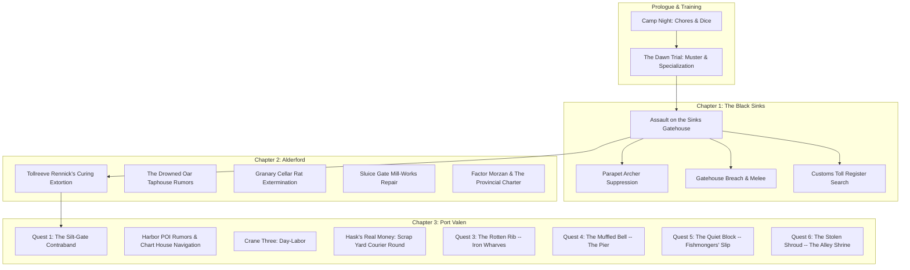

# Leftover from the old QUESTS.md

These parts of the old file were not quest write-ups. They are here word for word so nothing was lost when `QUESTS.md` became an index on 2026-11-16. Delete this file once you have taken what you want from it.

---

## Part: Old title, quest state standards and chapter diagram (old lines 1 to 63)

# Quests & Contracts Reference — The Carrion Company

A developer reference for every major quest, side contract, municipal task, and investigation across *A Mercenary's Path*. Keep this updated whenever a new quest, objective stage, or resolution branch is added.

---

## Quest State Architecture & Standards

All quests use standardized ChoiceScript lifecycle variables declared in `startup.txt`:
1. **Stage Flag (`[quest_name]_quest_stage`):**
   - `"unstarted"` — Initial state before the briefing, notice, or trigger event.
   - `"active"` — Accepted / ongoing; unlocks investigation choices, district travel goals, and POI scenes.
   - `"resolved"` — Finished; locks out repeatable investigation branches and updates district ambient prose.
2. **Resolution Flag (`[quest_name]_resolution`):**
   - Stores the narrative path taken (e.g. `"watch_seized"`, `"hush_money"`, `"leverage"`, `"scales_extorted"`).
3. **Intel & Evidence Flags:**
   - Tracks discovered clues, stolen manifests, or extracted names (`[quest_name]_full_intel`, `found_customs_vellum`, etc.).
4. **Reward & Claim Flags:**
   - One-time payout protection (`[quest_name]_bounty_claimed`), one-time regard flags (`vane_impressed_boom_report`), and unique items (`has_silt_gate_payout_slip`).

---

## Chapter Overview



---

## Part: Harbor places table and the world economy design note (old lines 372 to 396)

## Harbor POIs & Minor Contract Log

| Location | Quest / Activity | Requirements / Triggers | Rewards |
|---|---|---|---|
| **The Cleaved Keel Taphouse** | Tavern Dice Gambling & Port Valen Rumors | Open after Vane briefing (`pv_pois_open`) | Up to 15 Silver Marks, 3 unique district rumors |
| **Fishmongers' Slip** | **The Quiet Block** (see Quest 5 and `quest/FISH_SLIP_PLAN.md`): a dawn auction where a ring of buyers never bids against each other. Plus DEX/INT street food and gossip | Open Pre-Dawn to Afternoon; closed Dusk, Night, Storm and Blizzard; the auction is Pre-Dawn and Morning only | Up to 5 Silver Marks, or 3 Silver, or an ally (`wenna_favor`); failure costs stall prices |
| **Sail-Loft Ropes** | Rigging repairs, tarred hemp cordage, climbing gear | Open during daytime hours | Rigging tools for Sapper / Rogue checks |
| **Harbor Chart House** | Tidal charts, channel navigation, barge clearance (deferred: planned for the customs area, not its own Quayside stop) | Requires a specific quest/rank flag, not yet decided (`port_watch_rep` was removed 2026-11-08) | Tidal navigation advantages |
| **Iron Wharves** | The Rotten Rib investigation; allied contact on Slipway Two afterward | Daytime, fair weather only (gate closed at Dusk/Night/Pre-Dawn and in Storm/Blizzard) | Up to 14 Silver Marks, Brant's Iron-Heel Boots |
| **The Pier** | **The Muffled Bell** (see Quest 4 and `quest/MUFFLED_BELL_PLAN.md`): a night emergency at the wreck-bell. Plus the observe and lower-ladder scenes | The pier is open at any hour; the quest needs the wreck story, Night or Pre-Dawn, and Fog, Rain, Snow or Sleet | +5 silver, or `bell_resolution = "reported"`; a lost ketch on failure |
| **The Alley Shrine** (Dredge-End) | **The Stolen Shroud** (see Quest 6 and `quest/STOLEN_SHROUD_PLAN.md`): a stolen burial purse, a trail up Lamp Stair, a cellar. Plus the Hallowday broth line, Saint Althea's phials, and rumors | The hook needs a copper left in the bowl and a Hallowday with the friar at his kettle; three days to act | A Saint Althea's Water, or 2 to 6 silver; the friar sells a phial (50 copper, one per 30 days) after Returned or Pocketed |
| **Crane Three** | Repeatable dock day-labor for gang-boss Dell Ostrey | Daytime/Dusk only; first shift resolves a one-off headcount crisis | 3 Copper base + up to 4 Copper bonus per shift, once/day |

> **Removed:** the Tide-Well / Saint Althea shrine stop (it had no mechanics and the Alderford chapel and a planned city cathedral cover the same ground). Its two ambient hub lines stay as scenery.

### World Economy Layers (design note for the future trading simulator)

* **Quayside (physical layer):** warehouses, cranes, the fish market and the Fishmongers' Slip. Small lots, day wages, commoner trade.
* **Civic Heights (paper layer):** the Gilded Scales head house beside the Council Hall: banking and letters of credit, entry writs for the Patrician Quarter, dispatches, and the (later) contracts window. Alderford's counting house and Hendryk's factor's office at the Iron Wharves are branches of this. The **Patrician Quarter** is the merchant lords' private enclave (great houses, walled estates, the Terrace Walk, a tailor), reached by a Day Writ or Registered Writ bought at the head house.
* **The Pier (sea layer):** hulls, skiffs and later sea travel.
* **`wenna_favor`** (from The Quiet Block, strategic route) is reserved for wholesale dealing at the Slip.
* **Governance:** Port Valen is a **free city** (a status, not a name: it comes from an old Meridian charter, and other free cities can exist with their own governments; the carved legend reads "The Free City of Port Valen"), ruled by its Council (the Council of Factors, drawn from the senior merchant houses of the Gilded Scales). It is a plutocracy in practice, and the game never uses that word: the player sees it in the two tax-hall lines and the carved legend over the Council Hall, and the codex says "whoever controls the purse controls the city." The Free City's reach extends to the surrounding towns and villages of the river country, Alderford among them, through tolls, tax contracts and factors rather than garrisons. Old imperial charters (free-wharf exemptions, church toll immunity) are what the independents cite against it. Civic Heights is the seat of the Council, courts, tax and records offices and the Watch headquarters.

---

## Part: Old variables index (old lines 397 to 494)

## Complete Variables Index

```choicescript
*create silt_gate_quest_stage "unstarted"     *comment "unstarted", "active", "resolved"
*create silt_gate_resolution "none"           *comment "watch_seized", "hush_money", "leverage", "failed"
*create silt_gate_lookout_spotted false       *comment daytime recon reward
*create silt_gate_winch_jammed false          *comment daytime recon reward / mage hand
*create silt_gate_recon_done false            *comment tracks daytime scout completion
*create silt_gate_lamp_snuffed false          *comment prestidigitation stakeout buff
*create silt_gate_illusion_active false       *comment minor illusion stakeout buff
*create silt_gate_face_seen false            *comment a failed squeeze check: the porters saw your face (an hour lost)
*create silt_gate_bounty_claimed false        *comment one-time 20 silver watch payout guard
*create has_silt_gate_payout_slip false       *comment the broker's list of paid Watch sergeants (the one ending); turned in to Kestrel
*create kestrel_silt_briefed false            *comment Kestrel briefed the player; unlocks Voss's briefing
*create kestrel_slip_turned_in false          *comment the slip went to Kestrel
*create silt_gate_turned_in_day 0             *comment campaign_day of the turn-in; Voss notices three days later
*create silt_gate_voss_told false             *comment Voss's remark about the polite sergeants, shown once
*create kestrel_watch_leverage false          *comment Kestrel holds the names; RESERVED for future Watch quests
*create black_oath_status "outsider"          *comment "outsider", "contact", "associate"
*create vane_impressed_boom_report false      *comment Alderford boom report taken to Vane, not Varren (replaces the old vane_standing counter)

*comment --- Crane Three day-labor (see full label list above) ---
*create crane_quest_stage "unstarted"         *comment "unstarted", "active", "resolved"
*create crane_seen false                      *comment first-visit intro guard
*create crane_grievance_known false           *comment heard the boycotting dockers' side
*create crane_fee_bonus 3                     *comment 3 or 4 copper -- haggled once, persists every shift
*create crane_first_shift_method "none"       *comment "muscle", "rigging", "tally", "talked"
*create crane_shift_ontime false              *comment recomputed every shift
*create crane_shift_damaged false             *comment recomputed every shift
*create crane_job_unlocked false              *comment true once the repeatable loop is open
*create crane_shifts_completed 0              *comment lifetime counter -- future promotion ladder hook
*create crane_last_shift_day 0                *comment campaign_day of last shift -- one shift/day
*create crane_dell_regard 0                   *comment Dell's opinion -- future promotion gate

*comment --- Hask's Real Money / Scrap Yard Courier Round (see full label list above) ---
*create cut_scrap_sold_count 0                *comment times sold TO Hask specifically -- fires his offer at 6
*create scrap_vetting_offer_seen false        *comment Hask has raised the offer at least once
*create scrap_vetting_quest_stage "unstarted" *comment "unstarted", "active", "resolved"
*create scrap_vetting_day 0                   *comment campaign_day of the last delivery-round attempt; once/day
*create hask_courier_unlocked false           *comment first round resolved; unlocks the standing "run a round" option
*create hask_courier_count 0                  *comment lifetime SUCCESSFUL rounds; 6 opens named Oath work
*create hask_associate_offer_seen false       *comment Hask has revealed the employer
*create hask_associate_joined false           *comment one-time associate/rep award guard

*comment --- The Rotten Rib / Iron Wharves (see Quest 3 above) ---
*create rotten_rib_quest_stage "unstarted"    *comment "unstarted", "active", "resolved"
*create rotten_rib_resolution "none"          *comment "none", "blackmail", "failed"
*create rotten_rib_resolved false             *comment one-time completion guard
*create rotten_rib_resolved_day 0             *comment campaign_day of resolution -- drives Slipway Two prose
*create has_rotten_rib_splinter false         *comment physical proof from Brant, cleared on resolution
*create has_diverted_timber_waybill false     *comment Hendryk-stamped waybill; held on every ending until Ysolde takes it
*create ysolde_timber_briefed false           *comment asked Ysolde about the held-up timber orders
*create ysolde_timber_turned_in false         *comment waybill delivered to Ysolde
*create elric_alerted false                   *comment a failed approach or walk-away raised the alarm
*create rotten_rib_strikes 0                  *comment failed INT/STR/blackmail checks at Elric; the second ends the quest
*create rotten_rib_ledger_clue false          *comment read the Bay Four initials; advantage on the INT check against Elric
*create brant_favor false                     *comment unlocks the Slipway Two contact (blackmail ending only)
*create has_brant_iron_heel_boots false       *comment reward footwear
*create pv_tavern_rumor_rotten_rib false      *comment Cleaved Keel pre-seed rumor
*create pv_tavern_rumor_rotten_rib_after false *comment Cleaved Keel post-resolution rumor

*comment --- The Muffled Bell / The Pier (see Quest 4 above) ---
*create bell_quest_stage "unstarted"          *comment "unstarted", "active", "resolved", "failed"
*create bell_resolution "none"                *comment "none", "reported", "pocketed", "bloodied", "wrecked"
*create bell_resolved false                   *comment one-time completion guard
*create bell_heard_story false                *comment heard the old wreck story; opens the hook
*create bell_walked_away false                *comment turned back at the hook (wrecked without trying)
*create bell_hook_chance 20                   *comment percent chance per eligible pier visit
*create pv_tavern_rumor_bell false            *comment Cleaved Keel pre-seed rumor
*create pv_tavern_rumor_bell_after false      *comment Cleaved Keel post-resolution rumor

*create pv_slip_seen false                     *comment first-visit intro at the Fishmongers' Slip
*create fish_quest_stage "unstarted"           *comment "unstarted", "active", "resolved", "failed"
*create fish_resolution "none"                 *comment "lawful", "pragmatic", "strategic", "failed"
*create fish_resolved false
*create fish_resolved_day 0
*create fish_met_wenna false
*create fish_study_tried false                 *comment one-time INT DC 11 study of the buyers' hands
*create fish_saw_signals false                 *comment study success: advantage on route checks
*create fish_ring_wary false                   *comment study failure: +1 DC on every route check
*create fish_slip_shunned false                *comment failed lawful/pragmatic route: stalls charge +1 copper
*create wenna_favor false                      *comment strategic route; RESERVED for future wholesale dealing
*create pv_tavern_rumor_fish false             *comment Cleaved Keel pre-seed rumor
*create pv_tavern_rumor_fish_after false       *comment Cleaved Keel post-resolution rumor

*comment --- The Stolen Shroud / The Alley Shrine (see Quest 6 above) ---
*create shroud_quest_stage "unstarted"         *comment "unstarted", "active", "resolved", "failed"
*create shroud_resolution "none"               *comment "none", "returned", "fee", "pocketed", "escaped", "cold"
*create shroud_resolved false                  *comment one-time completion guard
*create shroud_seen false                      *comment the hook has been shown once
*create shroud_start_day 0                     *comment campaign_day the hook first appeared; starts the deadline
*create shroud_purse 40                        *comment coppers in the recovered purse; 30 after a failed trail roll
*create shroud_phial_ready_day 0               *comment first campaign_day the friar has another phial
*create shroud_deadline_days 3                 *comment days the family waits before the scene closes as "cold"
*create shroud_phial_wait_days 30              *comment days between phial batches
*create met_anselm false                       *comment the friar has given his name (Returned ending or first sale)
```

